# Bio Laboratory: Access Verification System

A door-access system for a high-security biomedical laboratory. A **C++ program** makes every decision with
hand-built data structures, and a **web front end** shows it: a wall-style **door device** for researchers and an
**admin panel** for security staff.

*Alliance University micro-project, Data Structures (C++).*

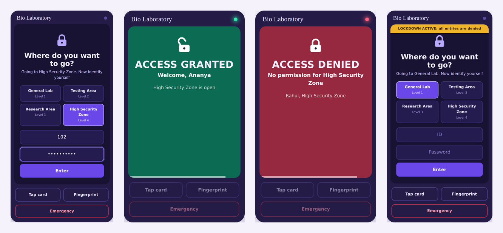

## Screenshots

### Door device (`/door.html`)
The candidate chooses the zone they want, identifies themselves (ID + password, NFC card or fingerprint) and the
device answers at once with a screen, a light and a beep, then resets for the next person.

| Choose zone and identify | Access granted | Access denied |
|---|---|---|
| 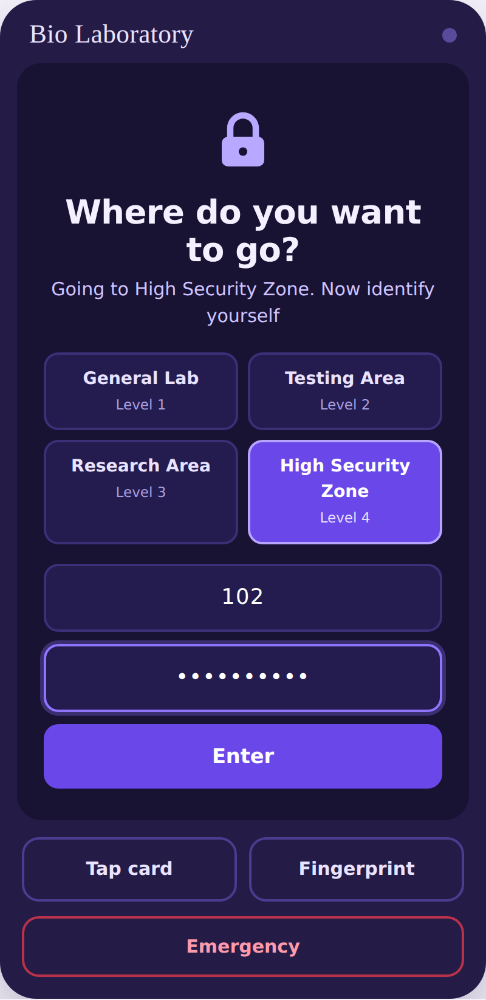 | 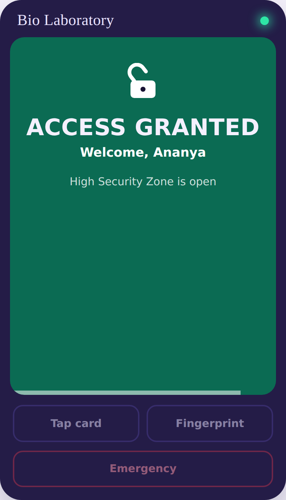 | 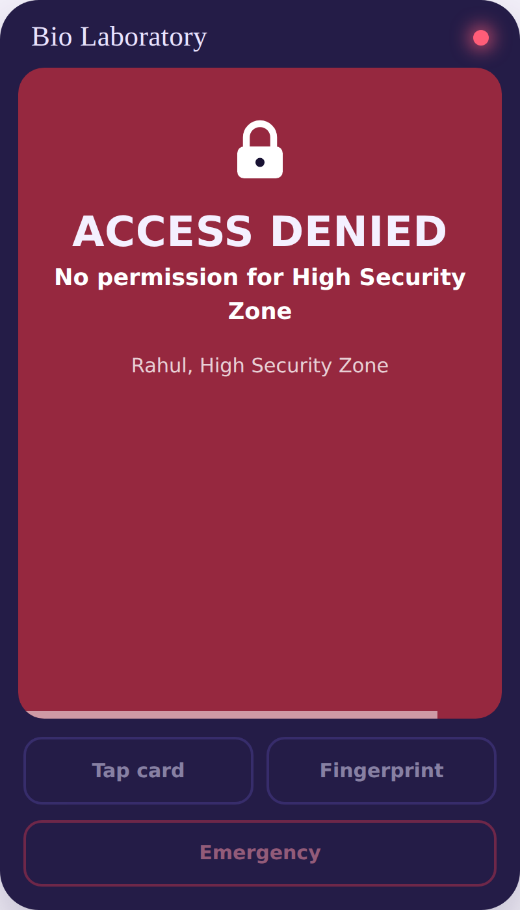 |

| Emergency button (asks to confirm) | Lockdown banner | Idle |
|---|---|---|
| 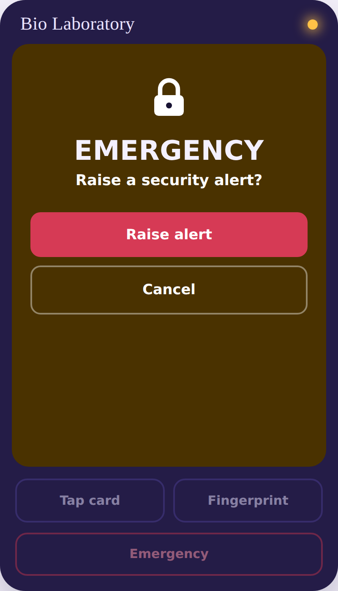 | 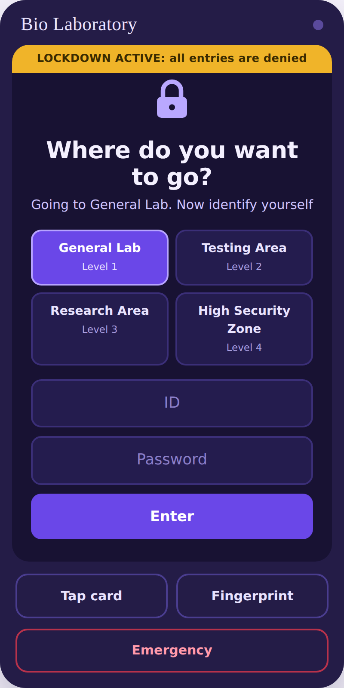 | 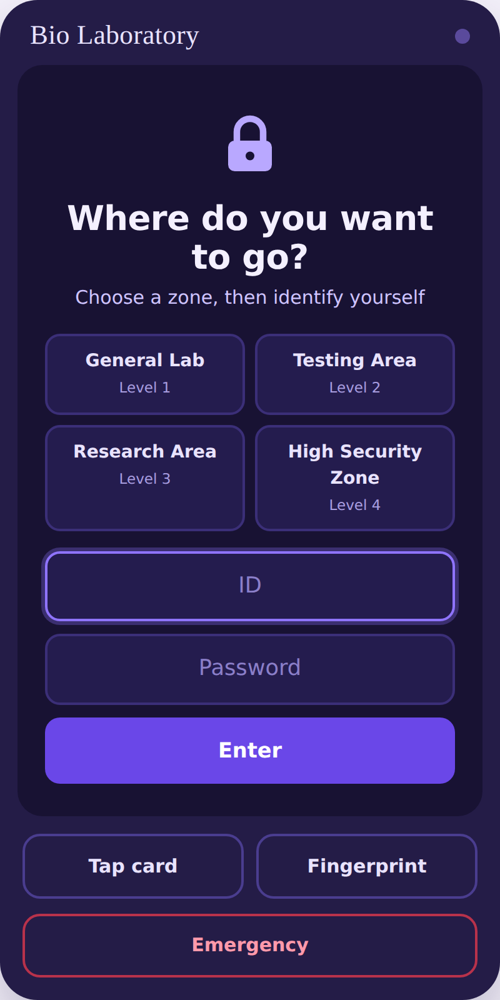 |

### Admin panel (`/`)
Live views of the circular queue and the emergency stack, the researcher hash table, the zone tree with
permissions, and the audit log.

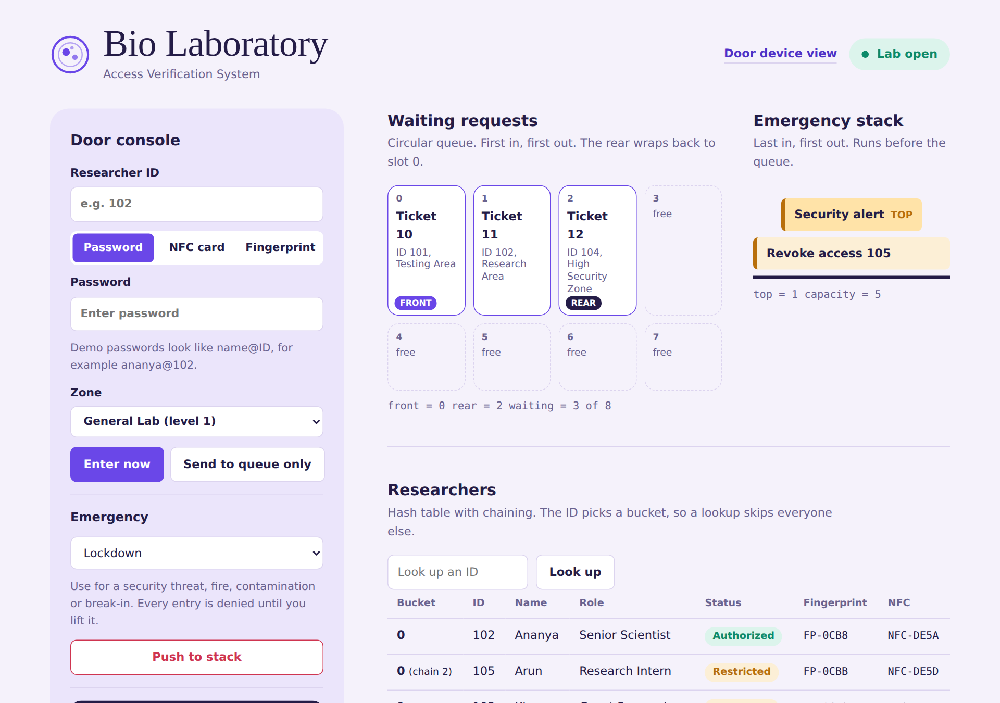

| Hash table with chaining | Zone tree and permissions |
|---|---|
| 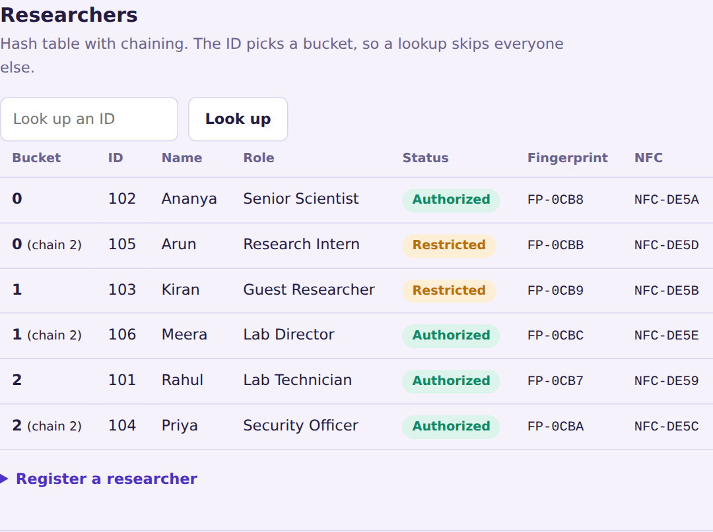 | 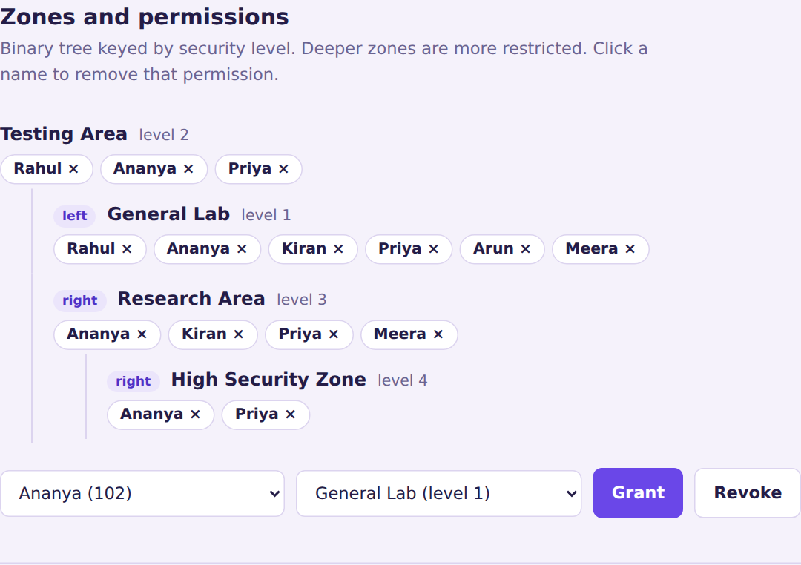 |

**Audit log:** merge sort by time, researcher or severity, and an animated binary search (green rows are matches).

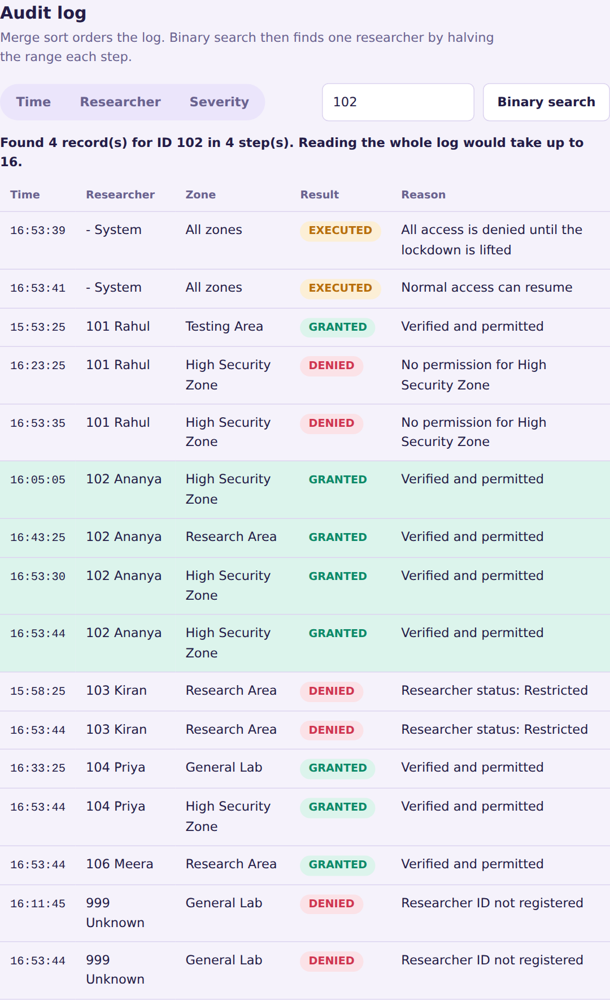

## Data structures (all in `main.cpp`)

| Part of the lab | Structure | Why |
|---|---|---|
| Researcher records | Hash table with chaining | Find a person by ID without scanning everyone |
| Normal requests | Circular queue (8 slots) | First come, first served; freed slots are reused |
| Emergency commands | Stack (5 slots) | The newest emergency must run first |
| Zones and permissions | Binary search tree + allowed-ID sets | Zones ordered by security level |
| Audit log | Merge sort + binary search | Sort once, then find a person by halving the log |

## How an entry is decided

The first failing check denies access:

1. Is the lab in lockdown?
2. Is the ID registered? (hash table)
3. Does the password, NFC code or fingerprint match?
4. Is the status Authorized (not Restricted or Revoked)?
5. Is the person on the chosen zone's permission list? (tree)

Every attempt, granted or denied, is written to the audit log.

## Emergencies

| Command | Use it when | Effect |
|---|---|---|
| Lockdown | Security threat, fire, contamination, break-in | Every entry is denied until lifted |
| Lift lockdown | The danger is over | Normal access resumes |
| Revoke access (ID) | Lost card, resigned or suspended person, suspicious activity | That ID is blocked |
| Restore access (ID) | Person cleared, card found | Status back to Authorized |
| Security alert | Something suspicious, nobody needs blocking | Recorded for security |

Security staff push these from the admin panel; they wait on the stack and the newest runs first.
Anyone can press **Emergency** on the door device, which raises a Security alert (never a lockdown).

## Quick start

No libraries to install. The web server is plain sockets, so it builds even on old MinGW.
Open a terminal **inside the project folder** (it must contain `public/`):

**Windows**
```
g++ -std=c++11 main.cpp -o labgate.exe -lws2_32
.\labgate.exe
```
(or double-click `build.bat`)

**Linux / macOS**
```
g++ -std=c++11 main.cpp -o labgate
./labgate
```

Then open:
- **http://localhost:8080/door.html** for the door device
- **http://localhost:8080/** for the admin panel

Use `localhost`, not `127.0.0.1`, if you want the real fingerprint reader (Windows Hello).

## Demo researchers

| ID | Name | Status | Password | Zones |
|---|---|---|---|---|
| 101 | Rahul | Authorized | `rahul@101` | General Lab, Testing Area |
| 102 | Ananya | Authorized | `ananya@102` | All four zones |
| 103 | Kiran | Restricted | `kiran@103` | General Lab, Research Area |
| 104 | Priya | Authorized | `priya@104` | All four zones |
| 105 | Arun | Restricted | `arun@105` | General Lab |

Zones: General Lab (1), Testing Area (2), Research Area (3), High Security Zone (4).
NFC and fingerprint are simulated (**Tap card** / **Fingerprint** on the device). On a laptop with a fingerprint
reader, enrol a researcher in the admin panel (choose Fingerprint, then **Enrol fingerprint**) to use Windows Hello.

## Saved data

Everything is stored in `labdata.txt` after every change and loaded at start-up: researchers and password
hashes, zones and permissions, the whole audit log, lockdown state, pending emergencies and ticket numbers.
Requests still waiting in the queue are not saved (they carry typed credentials).
Delete `labdata.txt`, or press **Reset demo data** in the admin panel, to start over.
The file is in `.gitignore`.

## Project layout

```
main.cpp            C++ program: data structures, rules, saving, API, web server
build.bat           one-click build and run on Windows
public/
  door.html .css .js     door device screen
  index.html style.css app.js   admin panel
docs/screenshots/   images used in this README
```

## Limits (honest notes)

- Password hashing is demo-grade (FNV-1a with a fixed salt). A real system would use bcrypt or Argon2.
- The fingerprint check trusts the saved credential ID; a real system would verify a signature on the server.
- The zone tree is not self-balancing (fine for 4 zones; an AVL tree is the next step).
- Plain HTTP on this computer only, one operator at a time.
"# bio-lab" 
